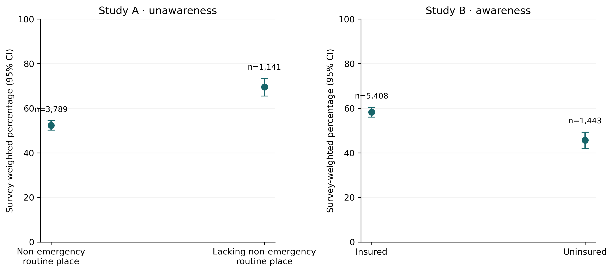
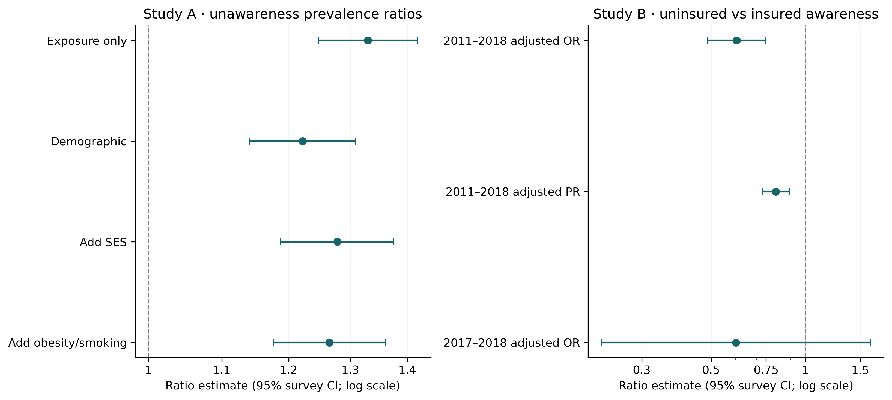
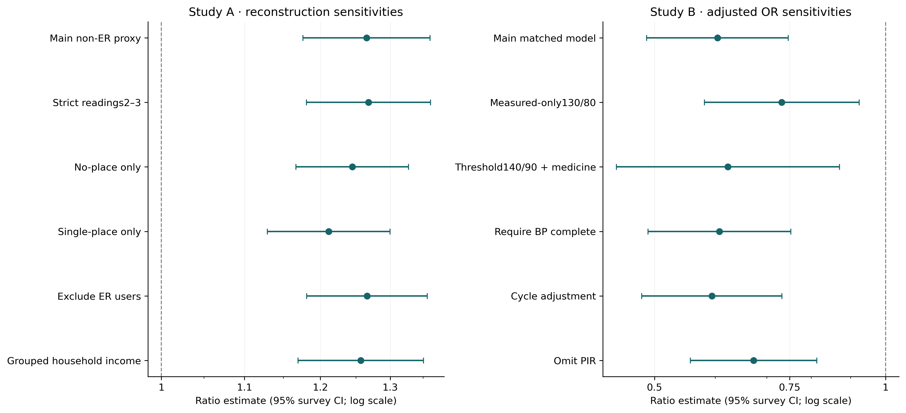

# Routine healthcare access, insurance coverage and reported hypertension recognition: NHANES 2011–2018

**Research-training manuscript draft, not peer reviewed.** Final specification follows the self-contained prompt. Prior single-cycle and preliminary pooled findings were known; revised operationalizations were documented before final fitting but are post-exploration. AI assisted coding and writing; applicant contributions require factual verification.

## Structured abstract

**Background:** Routine healthcare access and insurance are related but distinct aspects of care. This study pairs an approximate reconstruction of published routine-care/unawareness research with an insurance/awareness extension preserving a prior project's definitions.

**Methods:** Four official NHANES cycles2011–2018 were pooled with WTMEC8YR=WTMEC2YR/4. Study A targeted examined adults18–64 with measured BP≥130/80, using an explicit HUQ-based non-emergency-care proxy and reported diagnosis unawareness. Its Poisson model adjusted for selected demographic, socioeconomic and clinical variables; the exact published formula is unknown. Study B targeted ages 20–64 with measured elevation or current reported medication, with awareness as outcome and current insurance as exposure. Models matched original age/sex/race/education/PIR adjustment; cycle effects were sensitivity terms. Full survey design preceded domains; R survey was authoritative, with independent Python Taylor comparisons and R JKn refits.

**Results:** A4 n=4,930; unawareness55.9%, non-emergency routine-care78.9%, aPR1.27 (95% CI 1.18–1.36). These differ from published n=5,345,56.2%,81.7%,aPR1.20[1.12,1.29]. Study B n=6,191; aOR0.60 (95% CI 0.49–0.75) and aPR0.81 (95% CI 0.73–0.89) for uninsured versus insured awareness. Standardized difference-11.4percentage points(CI -16.1–-6.6). Prior J-only n=1,534,aOR0.60 (95% CI 0.22–1.62).

**Conclusions:** The care reconstruction supports a directionally compatible association but is not exact replication. Insurance was associated with lower reported awareness under matched pooled models. Temporal ambiguity, selection, missingness and working-model limitations prohibit causal claims.

## Introduction

Hypertension recognition is a healthcare-history construct, while measured blood pressure is a physiological observation at a survey visit. A person can report a previous diagnosis while current treatment controls measured pressure. Conversely, a participant can have an elevated examination measurement without recalling a professional diagnosis. A coherent study must distinguish these constructs, rather than label everyone with one elevated visit as clinically confirmed disease or everyone reporting no diagnosis as a proven detection failure.

Routine access may create opportunities for screening and communication, whereas insurance may affect affordability and care continuity. Neither construct can be replaced by the other. A usual healthcare place can be an emergency department, and a person with coverage can still lack an accessible provider. Current insurance is also observed after an unspecified lifetime diagnosis history. Illness-related employment or eligibility changes can therefore create reverse temporal pathways. We estimate descriptive adjusted associations, not the effect of supplying insurance or creating a care site.

Calixte and colleagues used NHANES 2011–2018 to relate routine-care access to unawareness in nonelderly adults[1]. Verified facts supplied for this task establish the period, measured130/80 case threshold, age18–64, unawareness construct, survey Poisson approach and benchmarks. They do not identify every exclusion, exposure recoding, BP averaging rule or final regression term. Our Study A accordingly reconstructs an explicit defensible analysis and reports disagreements. Numerical proximity alone does not verify a missing method.

Study B extends a preserved2017–2018 research-training project. Its target and medication-inclusive definition differ from Study A. Retaining the original adjustment variables permits a matched historical comparison while pooling four cycles offers more survey information. We hypothesized higher unawareness with lack of operational routine non-emergency care in A, and lower awareness among uninsured case-eligible adults in B. Both are established public-health questions, not claims of novel discovery.

## Related research and contribution

Egan et al. examined insurance-related hypertension care-cascade gaps in earlier NHANES periods[2]. Duru et al. studied insurance and hypertension monitoring/control[3]; CDC describes awareness by insurance and utilization in2011–2014[4]. Muntner et al. provides historical hypertension-control context through2017–2018[5]. Control, treatment and awareness are distinct endpoints. Different thresholds, ages, medication inclusion and periods preclude casual numerical comparisons across these studies.

Our limited contribution is a transparent reconstruction and an auditable extension: authentic source harmonization, maintained original definitions, explicit non-emergency-care assumptions, design-aware estimates, independent computations and honest incomplete replication. A focused literature comparison is not a systematic novelty assessment. Academic application materials should describe a reproducible training project rather than a peer-reviewed discovery or supervised investigation unless those facts are independently established.

## Methods

### Data, setting and preservation

Official CDC DEMO,BPX,BPQ,HUQ,HIQ files were obtained for G(2011–2012),H(2013–2014),I(2015–2016),J(2017–2018)[6]. Study A's prespecified obesity and smoking variables additionally required BMX and SMQ. No laboratory subsample was introduced. Preliminary unused DIQ/MCQ/DPQ caches are not part of final models. Components were merged within cycle using uniqueSEQN with one-to-one checks, then appended with cycle identifiers. No2017–March2020 prepandemic records were used. Raw codebooks, source URLs and SHA256 checks define the snapshot.

The original2017–2018 directory, results and writing remained unchanged. A historical copy accompanies the workspace, with file hashes; small aggregate reference results accompany the portable extension. Original tests run in an isolated copy, and J-only models execute anew in this extension. New protocol and ledger disclose earlier result knowledge; the project is retrospective and not prospectively preregistered.

### Blood-pressure and questionnaire definitions

Primary BP is the separate mean of available first3 systolic and diastolic readings under the original rule. Valid DBP0 remains valid; tiny XPORT zero representations are normalized. Missing values are not imputed and documented invalid paired readings fail validation. Study A requires both resulting means and a130/80 crossing. Alternate strict/available2–3 means are declared sensitivities, not verified author methods or benchmark-selected choices.

A unawareness is BPQ0202 among measured-high cases; BPQ0201 is awareness. Refused, don't-know and missing diagnosis are not coded unawareness. B uses the complementary reported-awareness outcome. B eligibility is a known elevated component or reported current BPQ050A1 medication at ages 20–64, including medication cases without measured BP. BPQ040A is ever advised medication and does not establish current use. In the extension skipped current-medication responses stay missing. The historical code's documented skip-no logic is recorded for audit; positive-case membership is unchanged, but negative-status denominators are not treated as interchangeable. No overall medication-inclusive national hypertension prevalence is inferred from those differing unknown-status rules.

### Exposures and harmonization

Study A's main lack-of-care variable combines HUQ030 with type-of-place follow-up HUQ040 inG and HUQ041 later. A no-place response denotes lack even when type is skipped. A reported usual/most-often emergency department is classified as lacking the operational non-emergency place. One/multiple places with known clinic,office,outpatient orother non-ER type indicate access. Unknown type and later code6 remain unknown where the primary place response does not resolve non-emergency status. Reporting an ER as usual/most-often is not proof that it is the only provider used. The construction is our proxy; exact Calixte handling is not verified.

Study B exposure is HIQ011 insurance status, insured1 versusuninsured2, with unknown responses excluded. Insurance is not a surrogate forHUQ. Different published and reconstructed care definitions are compared using declared sensitivities: no-place-only, single-place-only, and excluding ER-coded participants. These alter the estimand and support, not simply measurement precision.

Race/ethnicity is a social descriptor. A combines Hispanic categories and uses White/Black/Hispanic/Other; B retains the six original public-use groups. Adult education DMDEDUC2 applies at20+. For A18–19, known youth grades establish below-college status while “more than high school” does not establish degree and stays unknown. Smoking questions are20+ inG and18+ thereafter; structural ineligibility is not never-smoking. Never/former/current coding respects SMQ020/040 skip logic. Household-income alternatives preserve broad≥20k code12 as unresolved instead of inventing an upper income group. Continuous PIR is top-coded5; linearity is examined in sensitivity analysis.

### Models and survey inference

Study A1–A4 sequentially add demographics, SES and obesity/smoking to the operational exposure; all main steps use a common A4-complete population. A staged-sample alternative distinguishes missingness selection from added variables. The chosen adjustment set is scientifically motivated, not a reconstructed significance screen or a verified Calixte formula. Clinical traits can influence screening and may also follow diagnosis, so adjustment cannot identify a causal pathway.

B1 is unadjusted uninsured versus insured; B2 adds continuous age and sex; B3 adds original six-category race, four-category education and continuous PIR. Primary pooled formulas have no cycle term to match the historical model. Explicit cycle-adjusted, omit-PIR, functional-form and common-sample alternatives are reported. Logistic OR and modified-Poisson PR use the same covariates and eligibility within each step. ORs are not risk or prevalence ratios, and nested-model OR changes can reflect noncollapsibility as well as confounding and sample shifts.

The full positive-weight examination design precedes all domains, using WTMEC2YR/4, native masked strata andPSUs, nest=TRUE, noFPC and lonely-PSU fail[7]. Namespace equivalence is checked. This dataset has 59 strata,121PSUs and 62 full design degrees of freedom, rather than an assumed60. Rsvyglm provides Taylor covariance and model-residual-df coefficient intervals. Alternative full-design/normal calibrations are explicitly labeled. Group descriptors use their supported domain reference df and bounded beta/Korn–Graubard-type intervals with numericNCHS reliability screening[8].

### Missingness, standardization and checks

Complete cases are not presumed representative; MEC weights do not repair every later item missingness mechanism. Counts and percentages are tabulated by variable/cycle, with weighted retention and exposure/event support. A supplemental PIR response model uses observed outcome/exposure, demographics, auxiliary BP with a missing-BP flag, log exam weight andcycle. Nuisance auxiliary means, response and outcome models are refit inside survey JKn replicates. This assumes MAR conditional on measured predictors, positivity and model adequacy; it does not establish MAR or solve MNAR. Remaining non-PIR exclusions remain explicit.

B logistic predictions are standardized over its weighted complete-case covariate distribution. Joint Taylor influence includes coefficient and empirical-distribution uncertainty, with logit-transformed probability intervals and model-residual reference for the difference. Independent JKn model refits assess this nonlinear estimator. Poisson models can yield fitted means above1, which are flagged and never treated as individual probabilities. Python provides ETL, unit tests, figures and separate equivalent Taylor calculations; R survey is authoritative[9]. Full covariance matrices and independently rebuilt R masks/variables are compared, while R-only response weighting is not falsely called independently reproduced in Python.

## Results

Study A included 5,571 measured case-eligible adults and 4,930 fully adjusted complete cases. Its weighted unawareness prevalence was 55.9% (95% CI 54.0–57.9), compared with the56.2% benchmark; operational non-emergency routine-care prevalence was 78.9% (95% CI 77.1–80.5), compared with81.7%. The reconstructed aPR for lack of care was 1.27 (95% CI 1.18–1.36) (p=3.65e-08); published aPR was1.20[1.12,1.29]. Our adjusted sample was 415 fewer than the publication benchmark. These differences cannot establish what unpublished recoding/exclusion decisions were used.

Study B included 6,864 medication-inclusive case-eligible adults, with 6,191 complete cases in the fully adjusted model. Descriptive awareness was 58.2% (95% CI 56.0–60.5) among insured(n=5,408) and 45.7% (95% CI 42.1–49.3) among uninsured(n=1,443). These descriptive denominators differ from the covariate-complete regression sample. Matched-model aOR was 0.60 (95% CI 0.49–0.75) (p=1.64e-05); modified-Poisson aPR was 0.81 (95% CI 0.73–0.89) (p=4.63e-05). The measured-only first3 comparison yielded aOR 0.73 (95% CI 0.58–0.92) and aPR 0.85 (95% CI 0.75–0.97), n=4,951.

The preserved2017–2018 fully adjusted model had n=1,534 and aOR 0.60 (95% CI 0.22–1.62), p=0.201. Three J-only model specifications were rerun in the extension and compared with stored original outputs. The pooled point estimate is similar, with a narrower interval, but these are overlapping historical periods and not independent validation datasets. The cycle-adjusted sensitivity yielded aOR 0.59 (95% CI 0.48–0.73); it is deliberately not the matched primary specification.

Logistic standardized awareness was 57.8% (95% CI 55.6–60.1) under insured coding and 46.5% (95% CI 42.3–50.8) under uninsured coding, over the weighted I3 complete-case distribution. The difference was -11.4 percentage points(95%CI -16.1–-6.6). This standardization is associational and model-dependent.

Independent R JKn/Taylor SE ratios ranged 1.000–1.001, with 121 sampling-unit replicates. Exact equality is not expected. The R-only missing-PIR response sensitivity yielded OR 0.62(95%CI 0.51–0.76), target n=6,850, maximum inverse response factor 1.74. Every replicate refit response and outcome models; the MAR assumption remains unverified. This sensitivity was not independently implemented in Python.

Poisson diagnostics identified 77 fitted means above1 in A4 and 40 in I3_PR. These identify limitations of the unconstrained log-mean working models, not valid individual probabilities. Logistic predictions alone supplied standardized awareness probabilities. Sparse category/event counts and complete-case retention are retained in aggregate diagnostics; convergence is not proof of adequate overlap.

### Tables and sensitivity findings

[Tables1–3 with denominators and scientific comparability](TABLES.md) and [publication discrepancy analysis](REPLICATION_COMPARISON.md) accompany this report. The published sample count is not automatically the adjusted-model denominator in our reconstruction. All alternate case/exposure/model estimates are retained in regression.csv and their diagnostic tables; no closest-to-benchmark specification is promoted to primary.

- A4_strict23: PR 1.27 (95% CI 1.18–1.36),n=4,725.
- A4_no_place_only: PR 1.24 (95% CI 1.17–1.33),n=4,947.
- A4_single_place: PR 1.21 (95% CI 1.13–1.30),n=4,947.
- A4_household_income: PR 1.26 (95% CI 1.17–1.35),n=4,890.
- A4_no_clinical: PR 1.27 (95% CI 1.18–1.37),n=5,005.
- I3_measured: OR 0.73 (95% CI 0.58–0.92),n=4,951.
- I3_140: OR 0.62 (95% CI 0.45–0.87),n=3,989.
- I3_bp_complete: OR 0.61 (95% CI 0.49–0.75),n=6,093.
- I3_readings23: OR 0.66 (95% CI 0.53–0.82),n=6,204.
- I3_cycle: OR 0.59 (95% CI 0.48–0.73),n=6,191.
- I3_omit_PIR: OR 0.67 (95% CI 0.56–0.81),n=6,850.

Separate participant flows and captions are in figures/. Images also have vectorPDF versions.

## Discussion

The two analyses support different statements. A relates a reconstructed usual non-emergency-care proxy to reported unawareness within measured-high cases. B relates current insurance to reported awareness within a medication-inclusive case domain. A higher unawareness PR and a lower awareness OR/PR can both reflect recognition opportunity, but their magnitudes are not interchangeable and do not establish a common causal effect. Medication-only B cases are frequently aware by questionnaire linkage, whereas A excludes some successfully controlled aware adults. That conditioning can induce selection tied to treatment, recognition and access.

Approximate replication succeeded in implementing a transparent related analysis, not in verifying the exact published study. Differences in care prevalence are plausible under ER/multiple-place recoding; sample differences can arise through averaging and covariate missingness. Those explanations remain possibilities, not evidence that the authors used any particular unobserved method. Even an eligible-case sensitivity count matching5,345 would not verify final model inclusion. Benchmark comparisons are descriptive and correlated through the shared survey data; overlapping confidence intervals are not a formal reproduction test.

The pooled insurance association was more precise than the earlier single-cycle result under matched covariates. More sampled strata/PSUs support smaller design-based uncertainty, but this does not transform an observational association into a policy effect. Current coverage can follow diagnosis or illness-related changes in employment. Unmeasured geography, benefit generosity, coverage history, comorbidity and health literacy remain potential sources of residual explanation. CurrentPIR and clinical traits may occupy different temporal roles, and a conceptual adjustment story cannot order these variables empirically.

Complete-case and response-weighted estimates answer related targets under different assumptions. Modest observed inverse response factors are reassuring diagnostics but cannot establish response positivity in unobserved combinations or MAR for true missing income. The response sensitivity propagates estimation uncertainty; it does not recover unknown diagnosis/exposure histories or show how far any estimate is from truth. Full questionnaire and codebook checks improve consistency without eliminating recall, measurement or selection errors.

Unconstrained Poisson fitted means above1 warn against presenting the fitted values as probabilities or using them for policy standardization. Reported ratios remain modified-Poisson working-model associations with survey covariance, requiring adequate log-mean approximation. The logistic probability analysis supplies bounded descriptive standardization; it is not a replacement validation of every Poisson specification. Model and reference-distribution sensitivities should guide interpretation rather than select significance.

## Strengths and limitations

Strengths include authentic cached sources, cycle-specific mapping, unchanged historical work, matched baseline comparisons, full design before domains, independent raw-variable/mask/covariance checks, refitted nonlinear sampling-unit checks and aggregate-only faculty outputs. Automatic tests and failure state prevent stale success claims. Scientific interpretation explicitly tolerates unsuccessful exact replication and different estimands.

Limitations include unverified publication details, nominal-versus-supported younger ages, structural smoking/education gaps, incomplete cases, single-visit BP, self-reported lifetime diagnosis and current insurance, treatment-linked case selection, sparse category combinations, Poisson working-model violations, MAR/MNAR uncertainty and residual confounding. CDC documented cycle-specific nonresponse/location characteristics and enhanced calibration in2017–2018[10]; pooled analysis uses released weights but cannot independently remove every representation error. Findings concern2011–2018 and are not current prevalence or2021–2023 effects.

## Conclusion

A reproducible approximate Calixte reconstruction and a matched insurance extension produced interpretable historical associations with explicit uncertainty and methodological limits. The care reconstruction differs from published sample and estimates and cannot be described as exact replication. The pooled insurance estimate supports lower reported awareness among uninsured operational cases under the chosen model; causal and clinical interpretations remain unsupported. The contribution is research reasoning and transparent implementation, not an original discovery or a peer-reviewed publication.

## Contributions, ethics and funding

The applicant must verify actual independent contributions, funding/conflicts and institutional review requirements before external submission. This iteration includes substantial AI assistance. Public NHANES data have their own CDC ethical review/consent; no applicant-specific exemption or approval, faculty supervision or peer review was supplied or claimed.

## References

1. Calixte R,Chahal K,Besson A,Kaplan MS. Preventive Medicine2024;179:107843. [doi:10.1016/j.ypmed.2023.107843](https://doi.org/10.1016/j.ypmed.2023.107843),[PubMed](https://pubmed.ncbi.nlm.nih.gov/38176445/). Exact full formula/exclusions remain unverified; only final-task verified facts are used.
2. Egan BM etal. The growing gap in hypertension control between insured and uninsured adults:NHANES 1988–2010. Hypertension. 2014;64:997–1004. [doi](https://doi.org/10.1161/HYPERTENSIONAHA.114.04276).
3. Duru OK etal. Health insurance status and hypertension monitoring and control in the United States. American Journal of Hypertension2007;20:348–353. [doi](https://doi.org/10.1016/j.amjhyper.2006.11.007).
4. CDC/NCHS. [DataBrief278,2011–2014 hypertension unawareness](https://www.cdc.gov/nchs/products/databriefs/db278.htm).
5. Muntner P etal. Trends in blood pressure control among US adults with hypertension,1999–2000 to2017–2018. JAMA. 2020;324:1190–1200. [doi](https://doi.org/10.1001/jama.2020.14545).
6. CDC/NCHS. [Dataset documentation](https://wwwn.cdc.gov/nchs/nhanes/tutorials/datasets.aspx); exact official codebooks/URLs/hashes in the source manifest.
7. CDC/NCHS. [Weighting](https://wwwn.cdc.gov/nchs/nhanes/tutorials/weighting.aspx),[variance](https://wwwn.cdc.gov/nchs/nhanes/tutorials/varianceestimation.aspx).
8. Parker JD etal. [NCHS proportion presentation standards](https://www.cdc.gov/nchs/data/series/sr_02/sr02_175.pdf). Numeric screening is not agency clearance.
9. R survey package4.5,installed help/source and [CRAN](https://cran.r-project.org/package=survey).
10. CDC/NCHS. [2017–2018 nonresponse/sample-characteristics summary](https://wwwn.cdc.gov/nchs/data/nhanes/analyticguidelines/17-18-sampling-variability-nonresponse-508.pdf).
11. [STROBE observational reporting guidance](https://www.strobe-statement.org/).
